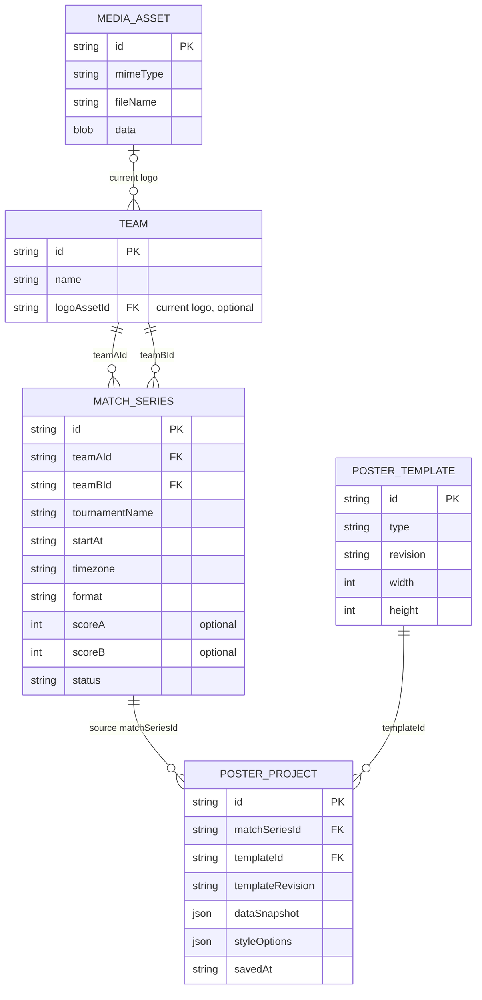

# DotaFrame — предварительная модель данных

**Версия:** 0.3  
**Статус:** Черновик на согласование  
**Связанная задача:** [#3](https://github.com/qroka/DotaFrame/issues/3)  
**Связанные требования:** [functional-requirements.md](../requirements/functional-requirements.md)

## 1. Цель модели

Обеспечить создание нескольких графических публикаций из одной серии Dota 2, повторное использование команд в разных матчах и **историческую неизменность всех отображаемых данных сохранённой публикации**.

Для MVP не нужна серверная БД. Объекты можно хранить локально в браузере, однако модель должна явно определять идентификаторы и ссылки между сущностями.

## 2. Схема сущностей



**PK** — уникальный идентификатор; **FK** — ссылка на другую сущность. В `MATCH_SERIES` две независимые ссылки на Team — `teamAId` и `teamBId`. Поле `dataSnapshot` содержит данные для рендеринга публикации, включая ID конкретных **неизменяемых версий** логотипов MediaAsset. Оно не является обычной ссылкой на текущие поля команды: это намеренная копия значений, зафиксированная при сохранении.

## 3. Описание сущностей

### 3.1. Team — справочник команд

| Поле | Тип | Правило |
|---|---|---|
| `id` | string | Обязательный уникальный локальный идентификатор, не зависит от названия |
| `name` | string | Обязательное отображаемое название |
| `logoAssetId` | string или null | Ссылка на локальный медиафайл; отсутствие логотипа допускается |

Одна команда может встречаться в любом количестве серий. Редактирование команды меняет её запись, а не создаёт копии в каждом матче. **Новые** публикации получают актуальные данные из справочника; **ранее сохранённые** публикации не меняются, поскольку все отображаемые данные фиксируются в `PosterProject.dataSnapshot`.

**Техническое правило:** для связей использовать ID, а не название. При переименовании Team Spirit в другом написании связи не должны теряться.

### 3.2. MediaAsset — изображения

| Поле | Тип | Правило |
|---|---|---|
| `id` | string | Уникальный ID |
| `mimeType` | string | Тип изображения после проверки файла |
| `fileName` | string | Исходное имя для отображения |
| `data` | Blob | Бинарные данные изображения в локальном хранилище |

**Почему отдельно:** ссылка вида `blob:...` живёт только в текущей сессии и не может служить постоянным адресом изображения. Для сохранения между перезагрузками следует хранить сам файл или его содержимое, например Blob в IndexedDB, и при открытии создавать временный объектный URL для просмотра.

Валидация типа и максимального размера файла должна быть проверена техническим экспериментом. SVG и иные форматы с активным содержимым требуют отдельной политики безопасности.

**Версионирование логотипов:** при замене логотипа нужно создать **новую** запись `MediaAsset` с собственным ID, а затем изменить только `Team.logoAssetId`. Нельзя перезаписывать бинарные данные старого `MediaAsset`, иначе публикации с историческими снимками незаметно изменятся. Старый файл сохраняется, пока на него ссылается хотя бы один снимок публикации.

### 3.3. MatchSeries — серия матчей

| Поле | Тип | Правило |
|---|---|---|
| `id` | string | Уникальный ID серии |
| `teamAId` | string | Ссылка на первую Team |
| `teamBId` | string | Ссылка на вторую Team; не равна `teamAId` |
| `tournamentName` | string | Название турнира; для MVP обычный текст |
| `startAt` | string | Однозначный момент времени, например ISO 8601 с часовым поясом |
| `timezone` | string | Часовой пояс для правильного отображения времени |
| `format` | string | Например, `BO3` или `BO5`; окончательный набор уточнить |
| `scoreA`, `scoreB` | number или null | Итоговый счёт; пустой до завершения серии |
| `status` | string | Например, `scheduled` / `completed` |

Время начала необходимо хранить без неоднозначности. Например, `2026-10-13T18:00:00+05:00` плюс `Asia/Yekaterinburg`. В интерфейсе можно выбрать единое правило ввода часового пояса.

**Инварианты:** участники существуют в справочнике, `teamAId !== teamBId`; завершённая серия должна иметь корректный счёт и определяемого победителя.

Для MVP **не создаём** сущности карты, драфта и отдельного турнира. Эти данные добавим, когда начнём проектировать графику карт и интеграцию с API.

### 3.4. PosterTemplate — готовый графический шаблон

| Поле | Тип | Правило |
|---|---|---|
| `id` | string | Стабильный ID шаблона |
| `type` | string | `announcement` или `series-result` |
| `revision` | string | Версия шаблона для воспроизводимого повторного экспорта |
| `width` | number | 1080 |
| `height` | number | 1080 |

Шаблоны входят в код приложения, а не создаются пользователем. При изменении шаблона должна сохраняться возможность повторного экспорта существующих снимков с нужной версией оформления. Точный способ версионирования проверим на архитектурном прототипе.

### 3.5. PosterProject — сохранённая публикация

| Поле | Тип | Правило |
|---|---|---|
| `id` | string | Уникальный ID сохранённой публикации |
| `matchSeriesId` | string | Ссылка на исходную серию **для навигации**, не источник значений при повторном рендеринге |
| `templateId` | string | ID выбранного шаблона |
| `templateRevision` | string | Версия оформления для воспроизведения |
| `dataSnapshot` | object | Копия **всех отображаемых значений** на момент сохранения |
| `styleOptions` | object | Сохранённые параметры оформления |
| `savedAt` | string | Время фиксации публикации |

**Минимальный состав `dataSnapshot` для MVP:**

- `teamA`, `teamB`: `teamId`, отображаемое `name`, `logoAssetId` (версия файла, а не ссылка на текущий логотип).
- `tournamentName`: текст турнира в изображении.
- `startAt`, `timezone`: сохранённые значения даты и времени.
- `format`: BO3/BO5 и другие поддержанные значения.
- `scoreA`, `scoreB`, `status`: результат и статус, если они выводятся в шаблоне.
- Любые другие отображаемые поля, которые будут добавлены в соответствующие шаблоны.

**Механика сохранения:**

1. До сохранения генератор может показывать актуальные поля из `MatchSeries` и `Team`.
2. По команде **«Сохранить публикацию»** создаётся `PosterProject` и в `dataSnapshot` записываются все значения, видимые на момент сохранения, включая ссылки на конкретные медиафайлы.
3. После сохранения открытая публикация рендерится **только из `dataSnapshot` и собственных параметров оформления**. Она не подтягивает изменения из `MatchSeries` или `Team`.
4. **Новая** публикация по той же серии получает текущие значения исходной серии и актуальные данные справочника.

Таким образом, `MatchSeries` остаётся редактируемым источником данных для новых изображений, а сохранённый `PosterProject` — самостоятельным снимком. Сохранённую публикацию нельзя незаметно переписывать, меняя её исходную серию.

**Предложение для MVP:** вместо изменения старого снимка действие «Создать копию» формирует новую публикацию с отдельным ID. Должна ли эта копия брать **старые зафиксированные данные** либо актуальные данные матча — определяем названием отдельного действия и уточняем на проектировании интерфейса.

## 4. Пример связей на уровне JSON

Ниже приведён **вымышленный** матч, а не действительное расписание Dota 2. ID изображений условные.

```json
{
  "teams": [
    { "id": "team-1", "name": "Team Spirit", "logoAssetId": "logo-2026" },
    { "id": "team-2", "name": "Team Liquid", "logoAssetId": "logo-liquid" }
  ],
  "matchSeries": [
    {
      "id": "series-1",
      "teamAId": "team-1",
      "teamBId": "team-2",
      "tournamentName": "Example Tournament",
      "startAt": "2026-10-13T18:00:00+05:00",
      "timezone": "Asia/Yekaterinburg",
      "format": "BO3",
      "scoreA": 2,
      "scoreB": 1,
      "status": "completed"
    }
  ],
  "posterProjects": [
    {
      "id": "poster-1",
      "matchSeriesId": "series-1",
      "templateId": "series-result",
      "templateRevision": "1",
      "dataSnapshot": {
        "teamA": { "teamId": "team-1", "name": "Team Spirit", "logoAssetId": "logo-2026" },
        "teamB": { "teamId": "team-2", "name": "Team Liquid", "logoAssetId": "logo-liquid" },
        "tournamentName": "Example Tournament",
        "startAt": "2026-10-13T18:00:00+05:00",
        "timezone": "Asia/Yekaterinburg",
        "format": "BO3",
        "scoreA": 2,
        "scoreB": 1,
        "status": "completed"
      },
      "styleOptions": { "theme": "dark" },
      "savedAt": "2026-10-13T21:30:00+05:00"
    }
  ]
}
```

Даже если исходная серия позже получит другой счёт, а команда — новый логотип, `poster-1` должен продолжать экспортироваться со значениями **2:1** и `logo-2026`.

## 5. Предварительные правила целостности

1. У `MatchSeries` две разные существующие команды: `teamAId !== teamBId`.
2. При переименовании команды её ID не изменяется.
3. Отсутствующий логотип отображается placeholder; изображение в экспортируемом PNG не должно быть битым.
4. Результат завершённой серии проверяется по выбранному формату.
5. При сохранении публикации все видимые данные серии, команд и настройки шаблона фиксируются согласованно, как один логический снимок.
6. Изменение команды, турнира, даты, времени или счёта в исходной `MatchSeries` не меняет `dataSnapshot` существующего `PosterProject`.
7. Для заменённого логотипа создаётся новый `MediaAsset`; старый не перезаписывается.
8. Медиафайлы, используемые хотя бы одним историческим снимком, нельзя удалять.
9. Если `MatchSeries` была изменена, новая публикация получает актуальные данные; старая остаётся прежней.
10. Для обеих публикаций MVP размер PNG — 1080 × 1080 пикселей.
11. Для повторяемости изображения нужно сохранять версию шаблона и обеспечивать доступность используемых шрифтов и ресурсов.
12. Физическое удаление команды или исходной серии не должно делать историческую публикацию нечитаемой. Политику удаления/архивирования согласовать отдельно.

## 6. Локальное хранение

Для MVP предлагается IndexedDB: отдельные хранилища `teams`, `mediaAssets`, `matchSeries`, `posterProjects`. Шаблоны — конфигурация в исходном коде приложения.

Это **архитектурная гипотеза**, а не утверждённый способ реализации. До разработки следует сделать небольшой прототип сохранения Blob и повторного открытия изображения.

## 7. Согласованные и открытые решения

**Согласовано:** все отображаемые данные матча и команд фиксируются при сохранении публикации; последующие изменения исходных записей на старую публикацию не влияют.

**Открыто:**

- **Редактирование снимка:** для MVP предложено создавать новую копию вместо изменения уже сохранённой публикации.
- **Удаление команд и серий:** архивирование, запрет удаления или другая модель?
- **Формат серий:** BO3/BO5 или также BO1?
- **Часовые пояса:** какой интерфейс выбора даты и времени нужен?
- **Резервное копирование:** нужен ли экспорт локальных проектов в файл?
- **Версии шаблонов:** как обеспечить корректную регенерацию старого PNG после обновления стилей приложения?

## 8. Следующие шаги

После согласования спорных правил уточнить архитектуру хранения, последовательность операций создания матча и структуру интерфейсов Figma.
