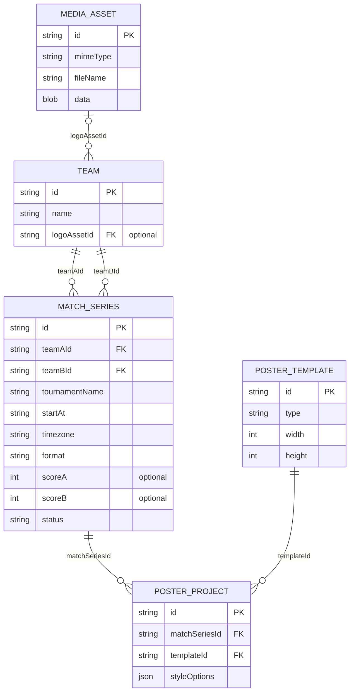

# DotaFrame — предварительная модель данных

**Версия:** 0.1  
**Статус:** Черновик на согласование  
**Связанная задача:** [#3](https://github.com/qroka/DotaFrame/issues/3)  
**Связанные требования:** [functional-requirements.md](../requirements/functional-requirements.md)

## 1. Цель модели

Обеспечить создание нескольких графических публикаций из одной серии Dota 2 и повторное использование данных команд в разных матчах.

Для MVP не нужна серверная БД. Объекты можно хранить локально в браузере, однако модель должна явно определять идентификаторы и ссылки между сущностями.

## 2. Схема сущностей



Обозначения: **PK** — идентификатор записи, **FK** — ссылка на идентификатор другой записи. Подписи `teamAId` и `teamBId` обозначают **две разные связи** от серии к сущности Team.

## 3. Описание сущностей

### 3.1. Team — справочник команд

| Поле | Тип | Правило |
|---|---|---|
| `id` | string | Обязательный уникальный локальный идентификатор, не зависит от названия |
| `name` | string | Обязательное отображаемое название |
| `logoAssetId` | string или null | Ссылка на локальный медиафайл; отсутствие логотипа допускается |

Одна команда может встречаться в любом количестве серий. Редактирование команды меняет её запись, а не создаёт копии в каждом матче.

**Техническое правило:** для связей использовать ID, а не название. При переименовании Team Spirit в другом написании связи не должны теряться.

### 3.2. MediaAsset — изображения

| Поле | Тип | Правило |
|---|---|---|
| `id` | string | Уникальный ID |
| `mimeType` | string | Тип изображения после проверки файла |
| `fileName` | string | Исходное имя для отображения |
| `data` | Blob | Бинарные данные изображения в локальном хранилище |

**Почему отдельно:** ссылка вида `blob:...` живёт только в текущей сессии и не может служить постоянным адресом изображения. Для сохранения между перезагрузками следует хранить сам файл или его содержимое, например Blob в IndexedDB, и при открытии создавать временный объектный URL для просмотра.

Валидация типа и максимального размера файла должна быть проверена техническим экспериментом. SVG и иные форматы с активным содержимым требуют отдельной политики безопасности.

### 3.3. MatchSeries — серия матчей

| Поле | Тип | Правило |
|---|---|---|
| `id` | string | Уникальный ID серии |
| `teamAId` | string | Ссылка на первую Team |
| `teamBId` | string | Ссылка на вторую Team; не равна `teamAId` |
| `tournamentName` | string | Название турнира; для MVP обычный текст |
| `startAt` | string | Однозначный момент времени, например ISO 8601 с часовым поясом |
| `timezone` | string | Часовой пояс для правильного отображения времени |
| `format` | string | Например, `BO3` или `BO5`; окончательный набор уточнить |
| `scoreA`, `scoreB` | number или null | Итоговый счёт; пустой до завершения серии |
| `status` | string | Например, `scheduled` / `completed` |

Время начала необходимо хранить без неоднозначности. Например, `2026-10-13T18:00:00+05:00` плюс `Asia/Yekaterinburg`. В интерфейсе можно выбрать единое правило ввода часового пояса.

**Инварианты:** участники существуют в справочнике, `teamAId !== teamBId`; завершённая серия должна иметь корректный счёт и определяемого победителя.

Для MVP **не создаём** сущности карты, драфта и отдельного турнира. Эти данные добавим, когда начнём проектировать графику карт и интеграцию с API.

### 3.4. PosterTemplate — готовый графический шаблон

| Поле | Тип | Правило |
|---|---|---|
| `id` | string | Стабильный ID шаблона |
| `type` | string | `announcement` или `series-result` |
| `width` | number | 1080 |
| `height` | number | 1080 |

В MVP шаблоны поставляются вместе с приложением; пользователь не создаёт собственную разметку. Сохранять их как полноценные объекты БД не требуется.

### 3.5. PosterProject — отдельная публикация

| Поле | Тип | Правило |
|---|---|---|
| `id` | string | Уникальный ID публикации |
| `matchSeriesId` | string | Ссылка на серию |
| `templateId` | string | Ссылка на готовый шаблон |
| `styleOptions` | object | Только поддерживаемые настройки (например, цвет и фон) |

Одна серия может иметь несколько публикаций. В PosterProject **не нужно дублировать** названия участников и турнира: по `matchSeriesId` находятся данные серии, а по `teamAId` / `teamBId` — команды.

Возможность создавать несколько экземпляров одного шаблона для одной серии оставляем открытой: она не обязательна для MVP.

## 4. Пример связей на уровне JSON

Пример условный: логотипы опущены, реальные идентификаторы создаются приложением.

```json
{
  "teams": [
    { "id": "team-1", "name": "Team Spirit", "logoAssetId": null },
    { "id": "team-2", "name": "Team Liquid", "logoAssetId": null }
  ],
  "matchSeries": [
    {
      "id": "series-1",
      "teamAId": "team-1",
      "teamBId": "team-2",
      "tournamentName": "Example Tournament",
      "startAt": "2026-10-13T18:00:00+05:00",
      "timezone": "Asia/Yekaterinburg",
      "format": "BO3",
      "scoreA": null,
      "scoreB": null,
      "status": "scheduled"
    }
  ],
  "posterProjects": [
    {
      "id": "poster-1",
      "matchSeriesId": "series-1",
      "templateId": "announcement",
      "styleOptions": { "theme": "dark" }
    }
  ]
}
```

Название турнира и дата здесь **условные**, а не сведения о реальном матче.

## 5. Предварительные правила целостности

1. Нельзя выбрать одну и ту же команду сразу в оба слота серии.
2. При смене названия команды её ID не изменяется.
3. При отсутствии логотипа шаблон использует нейтральный placeholder, а не битую картинку.
4. Серия не должна ссылаться на несуществующую команду.
5. Удаление команды, используемой в сериях, требует специального безопасного поведения. **Предложение:** не удалять такую запись физически, а архивировать её.
6. Обновление результата серии не должно сбрасывать стили публикации.
7. Формат экспорта для шаблонов MVP — PNG 1080 × 1080 пикселей.

## 6. Локальное хранение

Для MVP предлагается IndexedDB: отдельные хранилища `teams`, `mediaAssets`, `matchSeries`, `posterProjects`. Шаблоны — конфигурация в исходном коде приложения.

Это **архитектурная гипотеза**, а не утверждённый способ реализации. До разработки следует сделать небольшой прототип сохранения Blob и повторного открытия изображения.

## 7. Открытые решения

- **История публикаций:** если переименовать команду или заменить логотип, должны ли уже созданные публикации измениться автоматически или сохранить прежние данные?
- **Удаление команд:** архивирование, запрет удаления или другая модель?
- **Формат серий:** BO3/BO5 или также BO1?
- **Часовые пояса:** какой интерфейс выбора времени удобнее для SMM-редактора?
- **Резервное копирование:** нужен ли экспорт локальных проектов в файл?

## 8. Следующие шаги

После согласования спорных правил уточнить архитектуру хранения, последовательность операций создания матча и структуру интерфейсов Figma.
