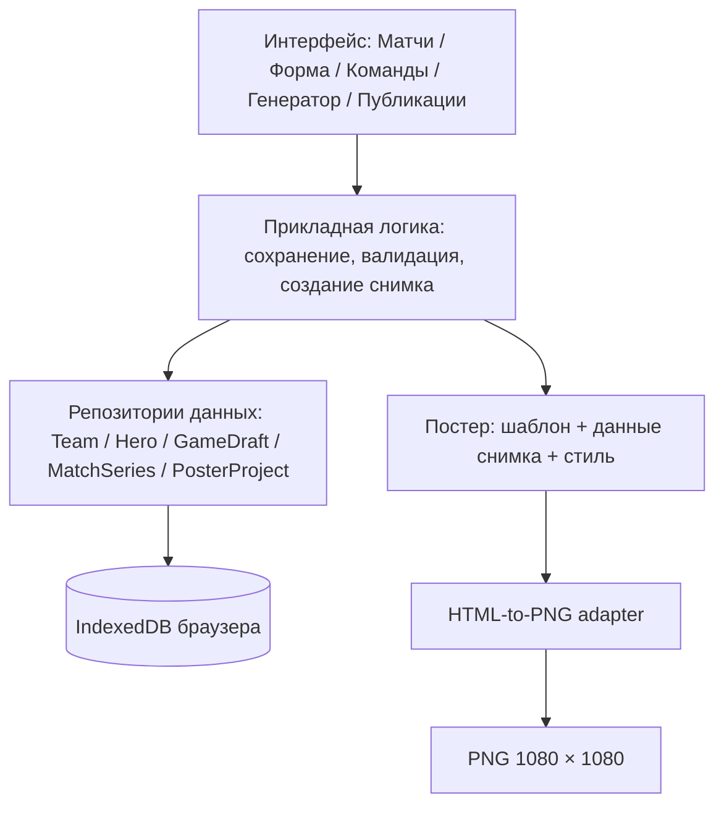

# DotaFrame — предварительная архитектура MVP

**Версия:** 0.2  
**Дата:** 13.10.2026  
**Статус:** проектное решение для реализации MVP; технические риски требуют проверки прототипом  
**Основание:** [требования](../requirements/functional-requirements.md), [модель данных](data-model.md), [границы MVP](../requirements/mvp-scope.md)

## 1. Цель и принципы

DotaFrame — браузерный генератор статичных публикаций для Dota 2. Данные матчей вводятся вручную, изображения создаются по трём готовым шаблонам и выгружаются как PNG 1080 × 1080. Регистрация, серверное API и платные поставщики данных для MVP не обязательны.

Ключевые принципы:

- **Единый источник актуальных данных:** справочник команд `Team` и серия `MatchSeries` служат для подготовки **новой** публикации.
- **Неизменяемая сохранённая публикация:** `PosterProject.dataSnapshot` содержит все значения, показанные на постере, включая турнир, время с часовым поясом, счёт и версии логотипов; `styleOptions` и `templateRevision` фиксируют оформление.
- **Без скрытых исправлений истории:** изменение справочника или серии не переписывает сохранённый постер. Для исправленного результата создаётся отдельный `PosterProject`.
- **Разделение логики и представления:** валидация, работа с данными, подготовка модели постера и HTML-шаблон не должны смешиваться в одном обработчике.
- **Безопасное поведение при ошибках:** отсутствующий логотип заменяется заполнителем, а сбой сохранения или экспорта явно сообщается пользователю.

## 2. Состав приложения

**Граница ответственности:** интерфейс не обращается к IndexedDB из каждого компонента напрямую, а использует функции слоя хранения. Рендеринг постера получает объект с подготовленными полями, а не читает состояние формы.

## 3. Основные модули (ориентир для Vanilla JS)

| Модуль | Назначение |
|---|---|
| `app` / routing | Навигация между экранами; точный механизм маршрутизации выбрать при реализации |
| `teams` | CRUD справочника, версии логотипов, поиск |
| `matches` | Создание и редактирование серий, проверка BO и счёта |
| `drafts` | Ручное заполнение GameDraft, назначение сторон, выбор героев, проверки пиков/банов |
| `heroes` | Локальный каталог героев Dota 2 и портретов/заглушек |
| `posters` | Создание неизменяемого снимка, получение сохранённых публикаций |
| `templates` | Три HTML/CSS-шаблона: анонс, результат серии и драфт карты |
| `preview` | Отображение постера с теми же данными и правилами, что при экспорте |
| `export` | Адаптер HTML → PNG и загрузка изображения |
| `storage` | Работа с IndexedDB, атомарные операции, миграции схемы |
| `validation` | Проверки полей, изображений и итоговых результатов |

Это логические границы, а не требование вводить отдельные пакеты или сложную архитектуру. Достаточно ES-модулей браузера.

## 4. Предлагаемое хранение данных

**Предлагается IndexedDB**: она поддерживает структурированные объекты и Blob, необходимые для логотипов. `localStorage` как основное место хранения файлов не использовать.

Хранилища по ID: `teams`, `mediaAssets`, `matchSeries`, `gameDrafts`, `posterProjects`. Каталог `heroes` может поставляться в виде статических данных приложения.

- Все сущности используют стабильные ID (`crypto.randomUUID()` при доступности).
- При замене логотипа или портрета героя создаётся **новый** `MediaAsset`; актуальная ссылка обновляется, а исторические файлы сохраняются.
- GameDraft хранит драфт одной карты выбранной серии с двумя командами Radiant/Dire, массивами 5 пиков на сторону и переменными списками банов.
- Сохранение PosterProject фиксирует `dataSnapshot` (все видимые данные), `styleOptions`, `templateId`, `templateRevision`, `savedAt`.
- Изменение данных MatchSeries не меняет уже созданные PosterProject.
- Исторические логотипы нельзя удалять, пока они используются хоть одним сохранённым PosterProject.
- Для MVP удаления связанных команд и медиафайлов лучше избегать; архивирование — перспективное решение. Сами публикации удаляются только после подтверждения, когда такое действие появится.
- Систему миграций IndexedDB и обработку `QuotaExceededError` заложить в базовую реализацию.
- Данные зависят от браузера, профиля, устройства и origin; очистка данных может удалить проекты. Предупреждение обязательно, файл резервной копии — решение после MVP.

**Ограничение:** окончательный выбор способа сохранения файлов подтвердить через небольшой прототип, в том числе после перезагрузки браузера.

## 5. Последовательность «анонс → результат»

1. Редактор добавляет две команды (одну команду можно использовать во многих матчах).
2. Создаёт MatchSeries на отдельной странице: команды, турнир, дату, время, часовой пояс и формат.
3. Открывает генератор, выбирает «Анонс» и настраивает допустимые параметры.
4. Генератор собирает **временную модель предпросмотра** из актуальных Team и MatchSeries.
5. Действие «Сохранить публикацию» создаёт новый неизменяемый PosterProject со снимком данных и конфигурацией оформления.
6. По сохранённому PosterProject выполняется экспорт PNG 1080 × 1080.
7. Позже редактор меняет счёт MatchSeries и создаёт **новый** PosterProject с шаблоном «Результат серии».
8. Первый анонс продолжает отображать прежние значения, даже если изменились название команды, турнир или время.

**UX-решение для MVP:** скачивание PNG доступно после успешного сохранения публикации. Это гарантирует, что экспортируемый постер имеет воспроизводимую сохранённую версию. До сохранения показывается интерактивный предпросмотр.

Сохранённые публикации открываются в режиме просмотра. Для исправления редактор возвращается к серии и создаёт новую публикацию; перезапись исторической записи без отдельного подтверждённого UX не поддерживается.

### Сценарий драфта карты

1. В MatchSeries пользователь выбирает карту, указывает стороны Radiant и Dire.
2. Вручную выбирает из локального каталога Hero пять героев каждой команды и заблокированных героев.
3. Система проверяет уникальность героев внутри карты и формат BO.
4. В генераторе пользователь выбирает шаблон «Драфт Dota 2», проверяет предпросмотр и сохраняет PosterProject.
5. В dataSnapshot фиксируются обе команды, карта, турнир, пики, баны и **версии портретов героев**, после чего доступен PNG 1080 × 1080.

**Не входит:** live-драфт, автоимпорт пиков/банов, порядок фаз Captain's Mode и счёт отдельной карты.

## 6. HTML-рендеринг и PNG

Оба шаблона представляют собой отдельные элементы HTML/CSS с **базовым фиксированным размером 1080 × 1080**. В интерфейсе они визуально масштабируются, но экспорт происходит в исходном размере.

**Кандидат на реализацию:** библиотека [html-to-image](https://github.com/bubkoo/html-to-image) с `toPng`. У неё есть параметры `width`, `height`, `pixelRatio`; итоговые пиксели нужно проверять автоматически и вручную. Библиотека может испытывать проблемы со сторонними изображениями, шрифтами, SVG `foreignObject` и отдельными CSS-эффектами. **Библиотека пока не протестирована в DotaFrame.**

Чтобы снизить риск:

- Перед экспортом дождаться загрузки шрифтов и декодирования изображений.
- Использовать локально загруженные Blob логотипов, а не непроверенные внешние URL; временные object URL вовремя освобождать.
- Не полагаться на внешние CDN в экспортируемом шаблоне.
- При экспорте не включать элементы управления редактора.
- Проверить PNG на кириллице, длинных названиях, отсутствии логотипов и изменённых темах.
- Если экспорт не удался, оставить сохранённый PosterProject и предложить повторить попытку.

При принципиальных проблемах браузерного экспорта возможно заменить адаптер или пересмотреть способ рендеринга; это отдельное техническое решение.

## 7. Безопасность и внешние ресурсы

- Пользовательские имена команд и турниров вставляются в DOM как **текст** (`textContent`), а не необработанный HTML.
- Для загрузки логотипов ограничить MIME, проверять фактический тип файла и максимально допустимый размер. До отдельной проверки SVG не принимать.
- Не выполнять код из внешних источников данных.
- В MVP никаких секретных токенов API в коде, репозитории или браузере.
- Право использования логотипов команд и игровых материалов требует отдельной проверки до публичного распространения.
- Постер с историческими данными должен быть воспроизводим, поэтому версии файлов и шаблонов сохраняются.

## 8. Состояния интерфейса

`loading`, `empty`, `editing`, `validation-error`, `saving`, `save-error`, `saved`, `exporting`, `export-error`, `completed`.

Сохранение и экспорт — отдельные операции с разными ошибками. Если экспорт не удался, сохранённые данные не должны исчезать.

## 9. Поддержка браузеров

**Первый целевой набор для тестов:** актуальные настольные Chrome и Firefox (Windows/macOS по доступности тестовых устройств). Edge — дополнительная проверка как Chromium-браузер. Safari и мобильные браузеры **не считаются проверенными** до отдельного тестирования.

Нельзя утверждать кроссбраузерность по одному успешному скриншоту. Проверить сохранение Blob, загрузку шрифтов и одинаковые размеры экспортированного PNG.

## 10. Что не является задачей MVP

Серверная база данных, аутентификация, API-интеграции, live-данные, коллаборация, произвольное перемещение слоёв, создание шаблонов пользователем, счёт/статистика отдельных карт и автоматическое получение драфтов. **Ручная графика драфта отдельной карты входит в MVP.**

## 11. Дальнейшие решения и проверки

- [Технический план проверок](../research/technical-feasibility.md).
- [Анализ возможных API](../research/api-research.md).
- [Архитектура экранов для Figma](../design/screen-architecture.md).
- [Требования к генератору драфтов](../requirements/draft-generator.md).

Архитектура описывает **план разработки**. Код приложения и проверки работоспособности ещё не выполнены.
