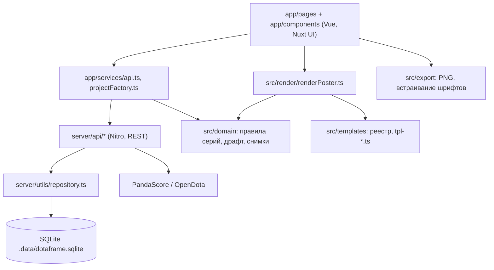

# DotaFrame — архитектура

**Версия:** 1.0 (Nuxt + SQLite)  
**Дата:** 12.11.2026  
**Предыдущая версия** (vanilla JS + IndexedDB): [archive/system-overview-v0.2-indexeddb.md](../archive/system-overview-v0.2-indexeddb.md)  
**Известные недостатки и план доработки:** [audit-and-plan.md](../audit-and-plan.md)

## 1. Принципы

- **Локальный инструмент.** Один пользователь, один процесс Nuxt, данные в локальном SQLite-файле. Авторизации нет.
- **Данные вводятся один раз.** Команды и матчи живут в справочниках, публикации создаются из них.
- **Неизменяемый снимок.** Публикация хранит собственный снимок данных (`project.data`), оформление (`project.style`) и версию шаблона. Смена логотипа, названия или счёта не меняет сохранённые постеры. Обновить снимок можно только явным действием «Обновить из матча».
- **Предпросмотр = экспорт.** Один конвейер `renderPoster` отдаёт DOM и для экрана, и для PNG.
- **Рендер не зависит от фреймворка.** `src/domain`, `src/templates`, `src/render` — чистый TypeScript без Vue и без хранилища; на них опираются и клиент, и сервер.

## 2. Состав

Nuxt работает как SPA (`ssr: false`) и одновременно как сервер API (Nitro).

## 3. Каталоги

| Путь | Назначение |
|---|---|
| `app/pages` | Маршруты: главная, команды, матчи, драфт карты, редактор, публикации, шаблоны, настройки |
| `app/components` | Vue-компоненты по областям; ключевой — `editor/EditorWorkspace.vue` |
| `app/services` | `api.ts` — типизированный клиент; `projectFactory.ts` — сборка данных и состояния публикации |
| `server/api` | REST-маршруты: `teams`, `matches`, `drafts`, `projects`, `media`, `settings`, `bootstrap`, `backup`, `system`, `integrations/pandascore` |
| `server/utils` | `database.ts` (подключение, миграции), `repository.ts` (запросы), `providers/*` и `pandascore-import.ts` (внешние данные) |
| `src/core` | Идентификаторы, события, DOM-хелперы, утилиты, `assets.ts` |
| `src/domain` | Правила серий и счёта, время, драфт, построение снимков |
| `src/data` | Только статический каталог героев (`heroes.ts`) |
| `src/templates` | Реестр шаблонов, общие примитивы, темы, фоны, шрифты, `tpl-*.ts`, контракт шаблона в `types.ts` |
| `src/render`, `src/export` | Рендер постера; PNG-экспорт (`html-to-image`) |
| `src/editor/store.ts` | История состояния (undo/redo) |

## 4. Хранение

SQLite через встроенный `node:sqlite`. Путь: `.data/dotaframe.sqlite`, переопределяется `DOTAFRAME_DATABASE_PATH`. Каталог `.data/` исключён из Git.

Таблицы: `teams`, `matches`, `match_games`, `external_entities`, `drafts`, `projects`, `revisions`, `media`, `settings`, служебная `schema_migrations`. Миграции (v1–v3) применяются последовательно при старте в `server/utils/database.ts`. Подробнее о сущностях — в [data-model.md](data-model.md).

- Изображения хранятся как BLOB в `media` и отдаются через `/api/media/:id`. Медиа неизменяемо: замена логотипа создаёт новую запись, старые снимки продолжают ссылаться на прежнюю.
- Каждое сохранение публикации добавляет неизменяемую запись в `revisions` (хранятся последние 30 версий публикации, лишние удаляются в `repository.ts`).
- Резервная копия: `GET /api/backup` потоком отдаёт обычный JSON (записи + изображения в base64), `POST /api/backup` восстанавливает объединением (upsert). Формат построчный: заголовок, маркер каждой таблицы и каждая запись лежат на своей строке, поэтому файл читается любым JSON-парсером, а восстановление обходится без загрузки файла в память. Каждая запись проверяется при чтении и складывается во временный файл SQLite на диске; в основную базу всё применяется одной синхронной транзакцией только после закрывающей строки файла (оборванная загрузка ничего не меняет, чужие запросы не попадают в транзакцию). Файлы старого формата восстанавливаются прежним путём в памяти (до 256 МБ). Реализация: `server/utils/backup.ts`.

## 5. Жизненный цикл публикации

1. Пользователь создаёт команды и матч (вручную или импортом из PandaScore).
2. `projectFactory.newProjectState` строит снимок данных из матча и шаблона.
3. Редактор показывает предпросмотр через `renderPoster`; правки меняют `data` и `style`.
4. «Сохранить» создаёт или обновляет проект и добавляет ревизию.
5. Экспорт сначала сохраняет публикацию, затем ждёт шрифты и декодирование изображений и растеризует кадр 1080 × 1080 в PNG 1080 или 1280 (`pixelRatio`). Фактический размер проверяется после экспорта.

## 6. Внешние данные

- **PandaScore** (`PANDASCORE_TOKEN`) — расписание и результаты матчей. Запрашивается только по действию пользователя после выбора локальных команд.
- **OpenDota** (`OPENDOTA_API_KEY`, необязателен) — пики и баны завершённых карт; сопоставление по точным названиям команд и времени. При неоднозначности данные не выдумываются, остаётся ручной редактор.
- Токены читаются только из серверного `runtimeConfig` (без `NUXT_PUBLIC_`) и не попадают в API или backup.

## 7. Безопасность и границы

- Сервер рассчитан на запуск на локальной машине и не имеет авторизации; `/api/backup` отдаёт всю базу любому, кто достучится до порта.
- Тексты вставляются в DOM как текст, не как HTML.
- Известные проблемы с отдачей SVG и проверкой типа файла описаны в [audit-and-plan.md](../audit-and-plan.md), раздел 1.5.

## 8. Тестирование

Vitest для чистой логики (`tests/unit`), Playwright для сценариев в Chromium и Firefox (`tests/e2e`). См. [testing.md](../testing.md).
