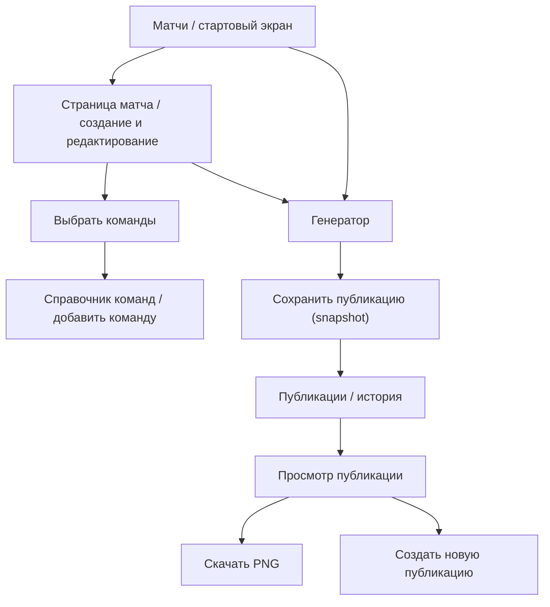

# DotaFrame — информационная архитектура и задание на wireframes

**Версия:** 0.4  
**Статус:** Черновик для Figma  
**Связанная задача:** [#3](https://github.com/qroka/DotaFrame/issues/3)  
**Основание:** [User Stories](../requirements/user-stories.md), [требования](../requirements/functional-requirements.md), [модель данных](../architecture/data-model.md)  
**Figma:** [DotaFrame | SOKRAL](https://www.figma.com/design/ck0P8u0kzEjoqUuylSsxrr) — пустой файл в пространстве SOKRAL DESIGN; макеты пока не созданы.

## 1. Цель проектирования

Спроектировать настольный веб-интерфейс генератора графики Dota 2. Главное действие: создать серию → выбрать шаблон → проверить предпросмотр → сохранить **неизменную** публикацию → получить PNG 1080 × 1080.

Не создавать полноценный редактор слоёв: пользователь меняет только предопределённые параметры шаблона.

## 2. Карта экранов

Справочник команд и сохранённые публикации также доступны из основной навигации, независимо от выбранного матча. Стрелки обозначают пользовательские переходы, а не требование к маршрутизатору браузера.

## 3. Экраны MVP

### S-01. Матчи

**Задача:** найти существующую серию, создать новую, исправить исходные данные и начать подготовку графики.

**Элементы:**
- Заголовок «Матчи», действие «Создать матч».
- Список или таблица серий: команды, турнир, дата и время, формат BO, статус/итоговый счёт.
- Быстрый поиск или фильтр по команде (желательно; включить после проверки объёма MVP).
- Действия для элемента: «Открыть», «Создать публикацию».
- Пустое состояние: «Пока нет матчей» + переход к созданию.

**Согласовано:** создание и редактирование матча выполняется **на отдельной странице S-01A**, а не в модальном окне. Переходы «Создать матч» и «Открыть» ведут на эту страницу.

### S-01A. Создание / редактирование матча (отдельная страница)

**Назначение:** заполнить или изменить данные серии до подготовки публикации.

**Структура:**
- Заголовок «Новый матч» либо «Редактирование матча», возврат в «Матчи».
- Блок «Участники»: два поля выбора из справочника (Team A / Team B), логотипы, действие «Добавить команду» рядом с каждым селектором. Добавление новой команды может открывать небольшой диалог; **это не** диалог создания матча.
- Блок «Информация о матче»: название турнира, дата, время, часовой пояс, формат серии (BO3/BO5; BO1 не входит в MVP).
- Блок «Результат»: статус серии; счёт появляется в режиме завершённого матча и проходит проверку на допустимость.
- Нижняя зона действий: «Отмена», «Сохранить матч», «Сохранить и создать публикацию»; на первом wireframe нужно проверить, не перегружает ли экран третье действие.

**Правила:** при выборе одинаковой команды в два слота отображать ошибку; незаполненные обязательные поля показывают локальную подсказку. При уходе с несохранённой формы — предупредить о потере данных. Добавление команды не сбрасывает текущую форму. Редактирование матча **не меняет** ранее сохранённые публикации.

**Первый wireframe:** desktop 1440 px; левое меню и основной контент, без графического превью публикации. Генератор — отдельный экран.

**Ошибки:** одинаковые команды, неверные даты, недопустимый итоговый счёт, ошибка сохранения.

### S-02. Команды

**Задача:** поддерживать единый справочник названий и логотипов.

**Элементы:**
- Список команд с логотипами и поиском.
- «Добавить команду».
- Редактирование названия и логотипа.
- Placeholder для команды без логотипа.
- Предупреждение: обновление команды применяется к новым публикациям, не к историческим снимкам.
- Удаление используемой команды не допускается без безопасного сценария; до согласования — действие скрыть или отключить.

**Ошибки:** пустое имя, неверный тип/размер изображения, недостаточно места в локальном хранилище, потенциальные дубли.

### S-03. Генератор

**Задача:** подготовить анонс, результат серии или драфт выбранной карты и проверить изображение до сохранения.

**Рекомендуемая компоновка desktop:**
- Верхняя строка: название проекта и матча, возврат к матчам, индикатор «Несохранённый предпросмотр».
- Левая панель: выбор одного из трёх шаблонов (анонс, результат, драфт), параметры темы и фона; для драфта — выбор карты и редактор пиков/банов, при необходимости переход к форме серии.
- Центральная область: уменьшенный **предпросмотр квадратного постера**, пропорции 1:1.
- Нижняя/верхняя зона действий: «Сохранить публикацию» и «Скачать PNG»; экспорт становится доступен **после успешного сохранения** нового снимка.

**Ограничение:** нет слоёв, перемещения, произвольной расстановки текста или смены размера элементов.

**Состояния:** загрузка логотипов, отсутствующее изображение, ошибка рендеринга, неподходящий для результата счёт, успешное сохранение, сообщение об ошибке.

**Ключевое поведение:** до сохранения предпросмотр отражает выбранные актуальные данные. По команде «Сохранить публикацию» создаётся **новый PosterProject**, содержащий `dataSnapshot` всех отображаемых значений, `styleOptions`, `templateRevision` и `savedAt`. Последующие изменения исходной серии и справочника не изменяют сохранённую публикацию.

### S-04. Публикации

**Задача:** открывать сохранённые снимки, повторно скачивать PNG и запускать создание нового материала.

**Элементы:**
- Галерея карточек с превью, типом шаблона, временем сохранения и описанием серии.
- «Открыть», «Скачать PNG», «Создать новую публикацию».
- Пустое состояние с переходом в «Матчи».
- Режим просмотра снимка — без редактирования его сохранённых данных.

**Важное UX-правило:** пользователь должен видеть, что открывает **историческую публикацию**, а не живые данные серии. Даже если серия или команда были обновлены, повторный экспорт старого снимка использует зафиксированные сведения.

**Правило MVP:** сохранённая публикация доступна в режиме просмотра/повторного экспорта. Для исправлений пользователь возвращается в исходную серию и создаёт **новую публикацию по актуальным данным**. Старую запись нельзя менять скрытно. Перенос прежнего оформления в новую публикацию — необязательное дальнейшее улучшение.

## 4. Основные пользовательские потоки

### F-01. Создание анонса с нуля

Матчи → Отдельная страница «Новый матч» → Добавить/выбрать команды → Указать турнир/время/BO → Сохранить матч → Открыть генератор → Шаблон «Анонс» → Настроить оформление → Предпросмотр → Сохранить → Скачать PNG.

### F-02. Результат после окончания серии

Матчи → Отдельная страница редактирования серии → Указать итоговый счёт → Генератор → Шаблон «Результат серии» → Предпросмотр → Сохранить **новый** PosterProject → Скачать PNG.

### F-03. Обновление логотипа команды

Команды → Открыть команду → Загрузить новый логотип → Сохранить новую версию MediaAsset → Открыть старую публикацию → убедиться, что в ней прежний логотип → Создать новую публикацию → увидеть актуальный логотип.

### F-04. Исправление результата матча после публикации

Матчи → Открыть серию → Исправить счёт → Сохранить серию → Публикации → открыть старую → убедиться, что счёт прежний → Создать новую публикацию по актуальным данным → сохранить новый снимок.

## 5. Компоненты для дизайн-системы Figma

**Общие:** navigation, page header, button, text field, select, date/time field, logo upload, dialog, confirmation, badge/status, toast/error, empty state, skeleton/loading.

**Предметные:** TeamSelect (с добавлением новой команды), TeamCard, MatchSeriesCard/Row, TemplateSelector, PosterPreview (1:1), PosterCard, StyleControls, ExportAction, HeroSelect, HeroSlot, DraftEditor, DraftBans.

**Состояния компонента:** default, hover, focus-visible, disabled, error, loading; для селектора — selected. Роли, подписи и сообщения об ошибках не должны определяться одним только цветом.

## 6. Структура Figma-файла

| Страница | Материалы |
|---|---|
| 01 — Research | Целевая аудитория, сценарии, ограничения MVP |
| 02 — User Flows | Потоки F-01–F-04 |
| 03 — Wireframes | S-01 «Матчи», S-01A «Создание/редактирование», S-02–S-04 и состояния |
| 04 — Foundations | Цвета, типографика, сетка, отступы |
| 05 — Components | Общие и предметные UI-компоненты |
| 06 — Screens | Детализированные экраны |
| 07 — Poster Templates | Три шаблона MVP: анонс, результат серии и драфт Dota 2; все 1080 × 1080 |
| 08 — Prototype | Кликабельные переходы по основным сценариям |

## 7. Начальные параметры фреймов

- Основной desktop-фрейм для исследования — **1440 px** по ширине; проверить также **1280 px** без горизонтальной прокрутки интерфейса.
- Сетка и конкретные размеры панелей **не утверждены**; подобрать при wireframes исходя из читаемости предпросмотра.
- Постер всегда имеет базовые размеры **1080 × 1080 px**, но на экране уменьшен пропорционально. Изменение масштаба предпросмотра не изменяет размер PNG.
- Мобильную компоновку исследовать позднее. Не обещать её в MVP без тестов.

## 8. Граница между Figma и программированием

Figma описывает композицию, связи экранов, визуальные компоненты и состояния. Данные о матчах и снимках описаны в документации архитектуры. Реализация на HTML + Tailwind CSS + Vanilla JS должна опираться на одну модель для предпросмотра и экспорта.

Перед подготовкой детальных макетов рекомендуется технический spike по экспорту HTML → PNG, включая кириллицу, загрузку логотипов, корректный размер 1080 × 1080 и сохранение Blob в IndexedDB.

## 9. Договорённости перед созданием Figma-макетов

- **Утверждено:** отдельная страница S-01A для создания/редактирования матча; основные экраны S-01–S-04; три шаблона MVP — анонс, результат серии и ручной драфт карты; PNG 1080 × 1080.
- **Рабочие настройки MVP:** BO3/BO5; три шаблона, включая ручной драфт карты с пиками/банами; заданные темы, фон и акцентный цвет; предварительный просмотр до сохранения, PNG после сохранения.
- **Сохранённая публикация:** только просмотр и повторный экспорт. Для исправлений — создание нового снимка из актуальной серии.
- **Открыто на уровне дизайна:** точная композиция, отступы и перенос длинного текста, варианты тем, отображение пояснений о локальном хранении.

Файл [DotaFrame | SOKRAL](https://www.figma.com/design/ck0P8u0kzEjoqUuylSsxrr) в **SOKRAL DESIGN** создан без экранов. Построение wireframes выполняется владельцем проекта.

## 10. Первые wireframes для реализации в Figma

**WF-01 — Матчи (1440 × 900):** левое меню ≈240 px (Матчи, Команды, Публикации); над контентом заголовок и основная кнопка «Создать матч»; ниже строка поиска (исследовательская), таблица серий с колонками «Команды», «Турнир», «Дата и время», «Формат», «Статус», «Действия». На первом wireframe достаточно трёх условных строк и пустого состояния отдельно.

**WF-02 — Новый матч (1440 × 900):** та же навигация; сверху возврат «К матчам», заголовок «Новый матч»; главный столбец шириной ≈760–840 px с последовательно расположенными блоками «Участники» и «Информация о серии»; справа узкий информационный блок с короткой подсказкой «Данные матча можно использовать повторно»; внизу формы действия «Отмена», «Сохранить матч». При показе итогового счёта в режиме редактирования появляется блок «Результат». Ширину уточнить после построения с учётом кириллицы и ошибок форм.

**Границы детализации:** серый wireframe, без цветовой дизайн-системы, без реальных логотипов команд; все элементы должны оставаться редактируемыми слоями Figma. На этом этапе оцениваем структуру, иерархию, сканирование формы, а не фирменный стиль.

**Проверка перед следующими экранами:** пользователь за 5–10 секунд должен находить действие создания матча; выбирать существующую команду или добавлять новую без потери данных; понимать, какие поля обязательны и как вернуться к списку.

## 11. Шаблон «Драфт Dota 2» (входит в MVP)

На странице `07 — Poster Templates` рядом с анонсом и результатом серии разместить третий редактируемый фрейм **1080 × 1080 px**. Это третий полноценный шаблон **MVP**, для которого также нужно спроектировать поля ручного ввода в генераторе.

**Состав макета:** две команды и их логотипы, по пять выбранных героев каждой стороны, место для заблокированных героев (число/группировка не должны зависеть от одной версии игрового патча), по необходимости турнир, номер карты и формат серии. Основной приоритет — читаемые пики и раздельное визуальное представление пиков и банов.

**Состояния для проверки:** заполненный драфт, отсутствующий портрет героя, длинное название команды, несколько вариантов отображения банов, уменьшенный предпросмотр внутри генератора. Имена и изображения героев — материалы, права использования которых нужно отдельно проверить до публичной публикации.

**Граница данных:** для MVP предусмотрены Hero и GameDraft, связанные с MatchSeries. Отдельную полную модель карты с результатом, статистикой и фазами Captain's Mode не создаём. Подробности — [спецификация драфтов](../requirements/draft-generator.md).

## 12. Дополнительный wireframe — WF-09: редактор драфта карты

В генераторе при выборе шаблона «Драфт Dota 2» отображать:

1. Выбор MatchSeries и номера карты в допустимом диапазоне BO3/BO5.
2. Выбор сторон Radiant/Dire для двух команд.
3. Пять слотов `HeroSelect` для пиков каждой команды и отдельные списки банов с возможностью ручного добавления героев.
4. Сообщения об ошибках для повторяющихся героев, незаполненных пиков и неправильного номера карты.
5. Квадратный предпросмотр (1:1) и сохранение неизменного PosterProject до PNG-экспорта.

На странице `07 — Poster Templates` подготовить третий Frame 1080 × 1080. В уменьшенном предпросмотре должны читаться команды, пять пиков с каждой стороны, баны и номер карты. Дополнительно проверить отсутствие изображений героев.

**HTML-референс:** отдельный статичный макет страницы `07 — Poster Templates` можно использовать как визуальную отправную точку; он не заменяет редактируемые Figma-фреймы и не является работающим генератором.
