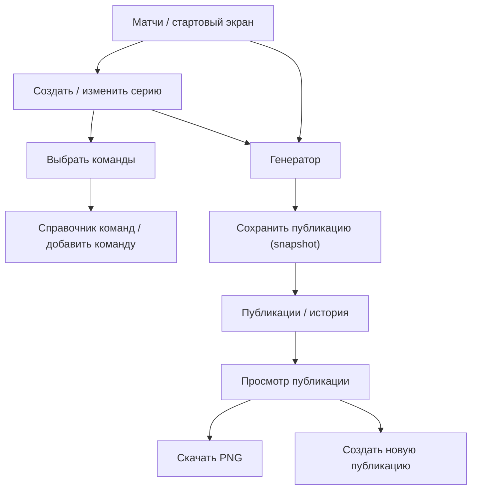

# DotaFrame — информационная архитектура и задание на wireframes

**Версия:** 0.1  
**Статус:** Черновик для Figma  
**Связанная задача:** [#3](https://github.com/qroka/DotaFrame/issues/3)  
**Основание:** [User Stories](../requirements/user-stories.md), [требования](../requirements/functional-requirements.md), [модель данных](../architecture/data-model.md)

## 1. Цель проектирования

Спроектировать настольный веб-интерфейс генератора графики Dota 2. Главное действие: создать серию → выбрать шаблон → проверить предпросмотр → сохранить **неизменную** публикацию → получить PNG 1080 × 1080.

Не создавать полноценный редактор слоёв: пользователь меняет только предопределённые параметры шаблона.

## 2. Карта экранов

Справочник команд и сохранённые публикации также доступны из основной навигации, независимо от выбранного матча. Стрелки обозначают пользовательские переходы, а не требование к маршрутизатору браузера.

## 3. Экраны MVP

### S-01. Матчи

**Задача:** найти существующую серию, создать новую, исправить исходные данные и начать подготовку графики.

**Элементы:**
- Заголовок «Матчи», действие «Создать матч».
- Список или таблица серий: команды, турнир, дата и время, формат BO, статус/итоговый счёт.
- Быстрый поиск или фильтр по команде (желательно; включить после проверки объёма MVP).
- Действия для элемента: «Открыть», «Создать публикацию».
- Пустое состояние: «Пока нет матчей» + переход к созданию.

**Создание/редактирование матча:** на первом этапе допустима отдельная форма или модальное окно; окончательный выбор — в wireframes. Поля: команда A, команда B, турнир, дата, время, часовой пояс, формат серии, статус и счёт при завершении. Из поля команды должен быть доступен сценарий «Добавить команду» без потери незаполненной формы.

**Ошибки:** одинаковые команды, неверные даты, недопустимый итоговый счёт, ошибка сохранения.

### S-02. Команды

**Задача:** поддерживать единый справочник названий и логотипов.

**Элементы:**
- Список команд с логотипами и поиском.
- «Добавить команду».
- Редактирование названия и логотипа.
- Placeholder для команды без логотипа.
- Предупреждение: обновление команды применяется к новым публикациям, не к историческим снимкам.
- Удаление используемой команды не допускается без безопасного сценария; до согласования — действие скрыть или отключить.

**Ошибки:** пустое имя, неверный тип/размер изображения, недостаточно места в локальном хранилище, потенциальные дубли.

### S-03. Генератор

**Задача:** подготовить анонс или результат выбранной серии и проверить его до сохранения.

**Рекомендуемая компоновка desktop:**
- Верхняя строка: название проекта и матча, возврат к матчам, индикатор «Несохранённый предпросмотр».
- Левая панель: переключатель шаблона, параметры шаблона (например, цветовая тема, фон), при необходимости редактирование данных через переход к форме серии.
- Центральная область: уменьшенный **предпросмотр квадратного постера**, пропорции 1:1.
- Нижняя/верхняя зона действий: «Сохранить публикацию», «Скачать PNG» (доступность экспорта без сохранения уточнить).

**Ограничение:** нет слоёв, перемещения, произвольной расстановки текста или смены размера элементов.

**Состояния:** загрузка логотипов, отсутствующее изображение, ошибка рендеринга, неподходящий для результата счёт, успешное сохранение, сообщение об ошибке.

**Ключевое поведение:** до сохранения предпросмотр отражает выбранные актуальные данные. По команде «Сохранить публикацию» создаётся **новый PosterProject**, содержащий `dataSnapshot` всех отображаемых значений, `styleOptions`, `templateRevision` и `savedAt`. Последующие изменения исходной серии и справочника не изменяют сохранённую публикацию.

### S-04. Публикации

**Задача:** открывать сохранённые снимки, повторно скачивать PNG и запускать создание нового материала.

**Элементы:**
- Галерея карточек с превью, типом шаблона, временем сохранения и описанием серии.
- «Открыть», «Скачать PNG», «Создать новую публикацию».
- Пустое состояние с переходом в «Матчи».
- Режим просмотра снимка — без редактирования его сохранённых данных.

**Важное UX-правило:** пользователь должен видеть, что открывает **историческую публикацию**, а не живые данные серии. Даже если серия или команда были обновлены, повторный экспорт старого снимка использует зафиксированные сведения.

**Предварительное предложение:** чтобы изменить готовый материал, использовать «Создать новую публикацию» с отдельным ID; копирование оформления старого снимка можно добавить в том же действии. Поведение при выборе устаревших или актуальных данных должно быть однозначно подписано.

## 4. Основные пользовательские потоки

### F-01. Создание анонса с нуля

Матчи → Создать матч → Добавить/выбрать команды → Указать турнир/время/BO → Открыть генератор → Шаблон «Анонс» → Настроить оформление → Предпросмотр → Сохранить → Скачать PNG.

### F-02. Результат после окончания серии

Матчи → Открыть ранее созданную серию → Указать итоговый счёт → Генератор → Шаблон «Результат серии» → Предпросмотр → Сохранить **новый** PosterProject → Скачать PNG.

### F-03. Обновление логотипа команды

Команды → Открыть команду → Загрузить новый логотип → Сохранить новую версию MediaAsset → Открыть старую публикацию → убедиться, что в ней прежний логотип → Создать новую публикацию → увидеть актуальный логотип.

### F-04. Исправление результата матча после публикации

Матчи → Открыть серию → Исправить счёт → Сохранить серию → Публикации → открыть старую → убедиться, что счёт прежний → Создать новую публикацию по актуальным данным → сохранить новый снимок.

## 5. Компоненты для дизайн-системы Figma

**Общие:** navigation, page header, button, text field, select, date/time field, logo upload, dialog, confirmation, badge/status, toast/error, empty state, skeleton/loading.

**Предметные:** TeamSelect (с добавлением новой команды), TeamCard, MatchSeriesCard/Row, TemplateSelector, PosterPreview (1:1), PosterCard, StyleControls, ExportAction.

**Состояния компонента:** default, hover, focus-visible, disabled, error, loading; для селектора — selected. Роли, подписи и сообщения об ошибках не должны определяться одним только цветом.

## 6. Структура Figma-файла

| Страница | Материалы |
|---|---|
| 01 — Research | Целевая аудитория, сценарии, ограничения MVP |
| 02 — User Flows | Потоки F-01–F-04 |
| 03 — Wireframes | S-01–S-04, состояния и формы |
| 04 — Foundations | Цвета, типографика, сетка, отступы |
| 05 — Components | Общие и предметные UI-компоненты |
| 06 — Screens | Детализированные экраны |
| 07 — Poster Templates | Анонс и результат серии, каждый 1080 × 1080 |
| 08 — Prototype | Кликабельные переходы по основным сценариям |

## 7. Начальные параметры фреймов

- Основной desktop-фрейм для исследования — **1440 px** по ширине; проверить также **1280 px** без горизонтальной прокрутки интерфейса.
- Сетка и конкретные размеры панелей **не утверждены**; подобрать при wireframes исходя из читаемости предпросмотра.
- Постер всегда имеет базовые размеры **1080 × 1080 px**, но на экране уменьшен пропорционально. Изменение масштаба предпросмотра не изменяет размер PNG.
- Мобильную компоновку исследовать позднее. Не обещать её в MVP без тестов.

## 8. Граница между Figma и программированием

Figma описывает композицию, связи экранов, визуальные компоненты и состояния. Данные о матчах и снимках описаны в документации архитектуры. Реализация на HTML + Tailwind CSS + Vanilla JS должна опираться на одну модель для предпросмотра и экспорта.

Перед подготовкой детальных макетов рекомендуется технический spike по экспорту HTML → PNG, включая кириллицу, загрузку логотипов, корректный размер 1080 × 1080 и сохранение Blob в IndexedDB.

## 9. Открытые решения

1. Форматы серии для MVP: BO3/BO5 или ещё BO1?
2. Отдельная форма создания матча или модальное окно?
3. Какие параметры оформления реально доступны в обоих шаблонах?
4. Как подписать «Создать новую публикацию» для старого снимка, чтобы не спутать старые и актуальные данные?
5. Как организовать резервные копии локального хранилища?
